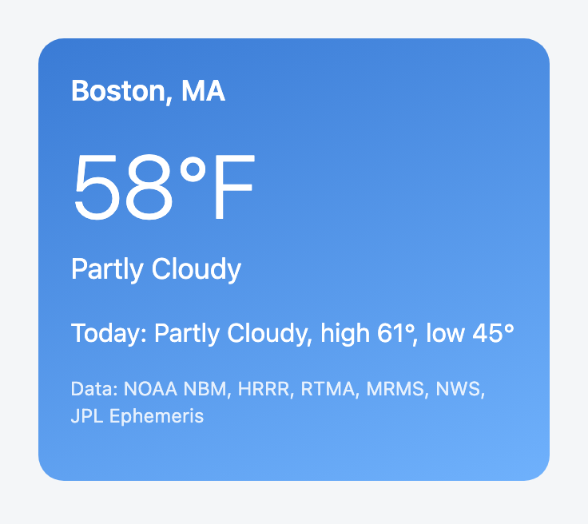

# A React weather card

A `useWeather` hook and a `<WeatherCard location />` component that show the
temperature and conditions now, today's forecast in one line, the first
active alert and the data sources. A Next.js route handler holds your key and
makes the one call, `GET /v1/weather`.



```tsx
<WeatherCard location="Boston, MA" />
```

| File | What it is |
| --- | --- |
| [`components/WeatherCard.tsx`](./components/WeatherCard.tsx) | The card. Plain React. |
| [`hooks/useWeather.ts`](./hooks/useWeather.ts) | `useWeather(location, { endpoint })` returns `{ data, error, loading }`, stays idle on an empty location, aborts on unmount and drops a response for an old location. Plain React. |
| [`lib/weather.ts`](./lib/weather.ts) | How a response becomes the card's lines or its error. Plain TypeScript, shared by the hook, the card and the tests. |
| [`app/api/weather/route.ts`](./app/api/weather/route.ts) | The server route the hook calls. It holds the key. |
| [`app/page.tsx`](./app/page.tsx) | The page that renders the card. |

## Why the key lives in a route

The API answers cross-origin requests only from Smarter Weather's own sites,
so a browser on your origin cannot call it directly, and a key shipped to a
browser is a key anyone can copy. The browser calls `/api/weather?location=...`
on your server, and the route calls the API with the key. The heart of
[`app/api/weather/route.ts`](./app/api/weather/route.ts):

```ts
const API_KEY = "YOUR_SMARTERWEATHER_API_KEY"; // insert your key here

const res = await fetch(`${API_BASE}/v1/weather?${query}`, {
  headers: { Authorization: `Bearer ${process.env.SMARTERWEATHER_API_KEY || API_KEY}` },
  signal: AbortSignal.any([request.signal, AbortSignal.timeout(10_000)]),
});
```

The route passes the status and body through, with `Content-Type`,
`WWW-Authenticate`, `Retry-After` and the `RateLimit-*` headers. It answers
a missing location with a 400 without calling the API, a timeout (10
seconds, body included) with a 504 and a network error with a 502, and it
cancels the API call when the browser goes away.

The hook, the card and `lib/weather.ts` import nothing from Next.js (a test
checks this), so they drop into any React app. Point `endpoint` at whatever
server route you have, in any framework or language, as long as it answers
with the `/v1/weather` JSON:

```tsx
<WeatherCard location="Denver, CO" endpoint="/my/weather" />
```

The route asks only for the sections the card shows (`include=current,daily,alerts`,
`days=1`). Drop those two parameters to get the whole response: the hourly
forecast, ten days, outlooks, and sun and moon times.

## Run it

Needs Node.js 22.22 or later, which the tests need (the app alone runs on
any Node.js that Next.js 16 supports).

```bash
npm install
echo "SMARTERWEATHER_API_KEY=..." > .env.local   # or edit the placeholder in the route
npm run dev
```

Open <http://localhost:3000>. An error shows in the card as `<status>: ` and
the problem's `detail` with a link to its recommended next step, or the start
of a body that is not a problem or not JSON. An empty `location` keeps the
card idle, with no request.

- Route: [`GET /v1/weather`](https://developers.smarterweather.com/api/weather/)
- Test: `npm test` builds the app, then runs the Vitest suite in
  [`test/`](./test/). It renders the card through the route against the mock,
  covers the error and missing-data states, the hook's requests (idle on an
  empty location, a stale response dropped), and the route's 400, timeouts,
  network error, forwarded headers and cancellation. Last,
  it runs [`test.json`](./test.json) through
  [`../../../_harness`](../../../_harness/): `test/call-route.mjs` starts the
  built app and prints the card's lines through `lib/weather.ts`, so the
  harness's five runs go through the route and the card's own formatting.
  Run it through `_harness/with-mock.sh`, which supplies the mock.
- The screenshot is the card rendering the API's documented example response
  from the mock, not live data.
- License: code [MIT](../../../../LICENSE), prose [CC BY 4.0](../../../../LICENSE-docs)
